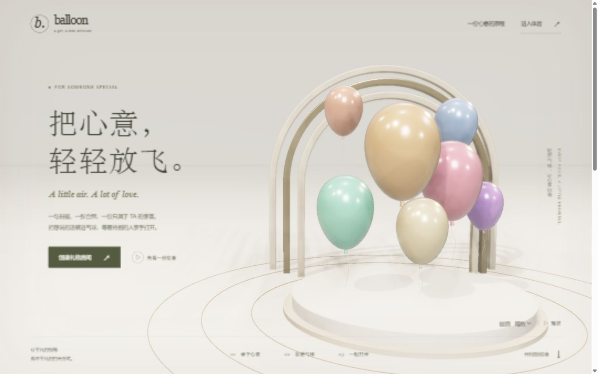

# Balloon Burst Gift · 气球送礼系统

把声音、文字和照片装进气球，让收礼者在实时三维空间中亲手打开祝福。适合生日、纪念日、毕业和朋友之间的集体送礼。

项目基于 React、TypeScript、Vite 和 Three.js，提供从创建房间、收集礼物到发布收礼现场的完整流程。



## 功能

- **创建礼物房间**：填写房间标题、收礼者称呼和提示语，生成制作链接与管理链接。
- **制作气球**：录制祝福、选择颜色、上传照片，并在三维场景中实时预览。声音参数会影响气球大小、轮廓、明暗与表面声纹。
- **管理与发布**：组织者查看礼物、移除不需要的气球，并发布收礼链接。
- **互动收礼**：轻触气球播放语音并释放文字、图片与署名；长按蓄能按钮可一次打开全场气球。图片可以放大查看，礼物碎片可以拖动。
- **直接体验**：访问 `/experience` 即可试玩示例礼物，并随时重新体验，无需先创建房间。

## 快速开始

建议使用 Node.js 22 或更新的 LTS 版本，以及 npm。

```sh
git clone https://github.com/jia-shu11/balloon-burst-gift.git
cd balloon-burst-gift
npm ci
npm run dev
```

打开终端显示的地址，默认是 `http://localhost:5173`。进入首页创建房间，或直接打开 `http://localhost:5173/experience` 试玩。

录音需要允许麦克风访问，并在 `localhost` 或 HTTPS 环境下使用。

## 送礼流程

1. 组织者在首页创建房间，保存管理链接。
2. 将制作链接分享给朋友，邀请大家录制祝福并上传照片。
3. 组织者在管理页整理礼物，发布收礼现场。
4. 将发布后的收礼链接交给收礼者，由 TA 打开气球。

| 页面 | 地址 | 用途 |
| --- | --- | --- |
| 首页 | `/` | 创建房间、查看三维展示 |
| 体验空间 | `/experience` | 试玩示例礼物 |
| 送礼制作 | `/gift/:inviteToken` | 录音、选色、上传照片 |
| 组织者管理 | `/manage/:manageToken` | 查看、删除礼物并发布 |
| 收礼现场 | `/r/:recipientToken` | 打开已发布的礼物 |

制作、管理与收礼使用不同的链接。管理链接具有房间管理能力，请仅由组织者保管。

## 数据模式

### 本地体验

无需配置后端即可运行。没有可用的 Supabase 配置时，系统使用当前浏览器的 `localStorage` 保存房间和礼物；录音与图片也保存在本地数据中。

本地模式适合开发与演示。链接只能访问同一浏览器内的数据，不能用于跨设备收集或分享礼物。浏览器存储容量有限，录音和图片过大时会提示空间不足。

可在 `.env.local` 中显式设置：

```dotenv
VITE_REPOSITORY_MODE=local
```

### Supabase 跨设备分享

1. 创建可用的 Supabase 项目。
2. 在 Supabase SQL Editor 中执行 [`supabase/schema.sql`](supabase/schema.sql)。脚本包含房间与礼物表、按链接令牌访问的 RPC、权限配置，以及 `gift-media` 存储桶和策略。
3. 根据 [`.env.example`](.env.example) 创建 `.env.local`，填写实际项目配置：

```dotenv
VITE_REPOSITORY_MODE=supabase
VITE_SUPABASE_URL=https://your-project.supabase.co
VITE_SUPABASE_ANON_KEY=your-anon-key
```

4. 重启开发服务器；部署环境修改变量后，需要重新构建。

`VITE_SUPABASE_ANON_KEY` 使用浏览器端的 anon key；不要填写服务端 `service_role` 密钥。上面的占位值必须替换为真实配置。缺失、占位或已知不可用的配置会回退到本地模式。

云端录音与图片上传到 `gift-media`。当前媒体桶使用公开读取策略，获得媒体地址的人可以访问该文件。

## 三维画面

首页、制作预览和收礼现场共用 Three.js / WebGL2 渲染器。气球、丝线、拱廊、展台和地面嵌线均为三维网格，场景无需下载外部模型或贴图。

- 珍珠乳胶物理材质，包含清漆、轻微透射、虹彩和生成式环境反射。
- 暖冷补光、柔化阴影、悬浮与丝线动画，以及三维射线点击检测。
- 精致画质增加环境遮蔽、景深、泛光和电影色调映射。
- 爆破使用实例化三维碎片；首页与制作页支持拖动镜头。
- 手机默认流畅画质，可切换画质和暂停动态；支持系统减少动态偏好与离屏暂停绘制。
- WebGL2 不可用或显卡上下文丢失时，切换到兼容画面，保留送礼与键盘交互。

这是浏览器实时三维渲染。实际帧率受设备性能、窗口分辨率和礼物数量影响；低性能设备可以选择「流畅」。

渲染引擎按需加载。录音期间复用模型与物理材质，轮廓更新最多每秒四次，音量动画逐帧响应。

## 构建与部署

```sh
npm run build
npm run preview
```

构建输出目录为 `dist`。`preview` 用于本地检查构建结果。

部署到 Vercel 时，导入该 GitHub 仓库，使用以下配置：

- 框架：Vite
- 安装命令：`npm ci`
- 构建命令：`npm run build`
- 输出目录：`dist`

跨设备送礼需要在部署项目中配置上述 Supabase 环境变量。仓库的 [`vercel.json`](vercel.json) 为体验页、制作页、管理页和收礼页配置了 SPA 路由回退。

部署到其他静态托管平台时，也需要将这些前端路由回退到 `index.html`，以支持直接访问和刷新。

## 开发与验证

```sh
# TypeScript 检查
npm run lint

# 测试，限制并发以降低内存占用
npm run test -- --maxWorkers=2 --minWorkers=1

# 测试监听模式
npm run test:watch
```

测试覆盖房间与礼物存储、录音与音频分析、制作和收礼交互，以及三维模型闭合性、坐标投影、资源复用和兼容降级。

## 代码结构

```text
src/
  pages/                 页面和路由入口
  features/giver/        录音、上传与气球制作
  features/manage/       礼物管理与发布
  features/recipient/    收礼交互和碎片操作
  domain/                数据类型与声音到气球参数的映射
  data/                  本地和 Supabase 数据访问
  visual/three/          三维模型、渲染引擎与后期处理
  styles/                页面样式
supabase/schema.sql      云端数据库、RPC 与媒体配置
```

主要渲染入口：[`BalloonScene.tsx`](src/visual/three/BalloonScene.tsx)。
